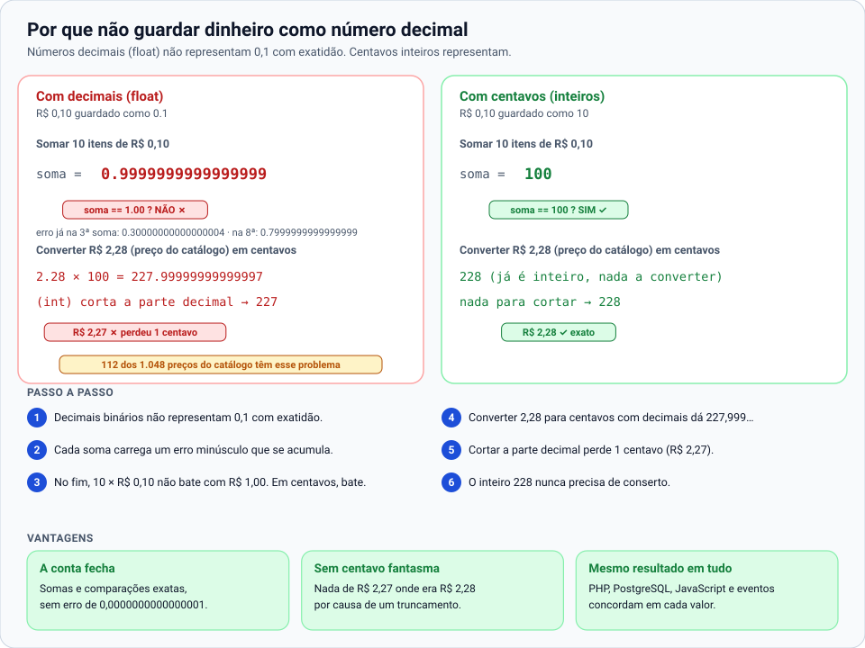
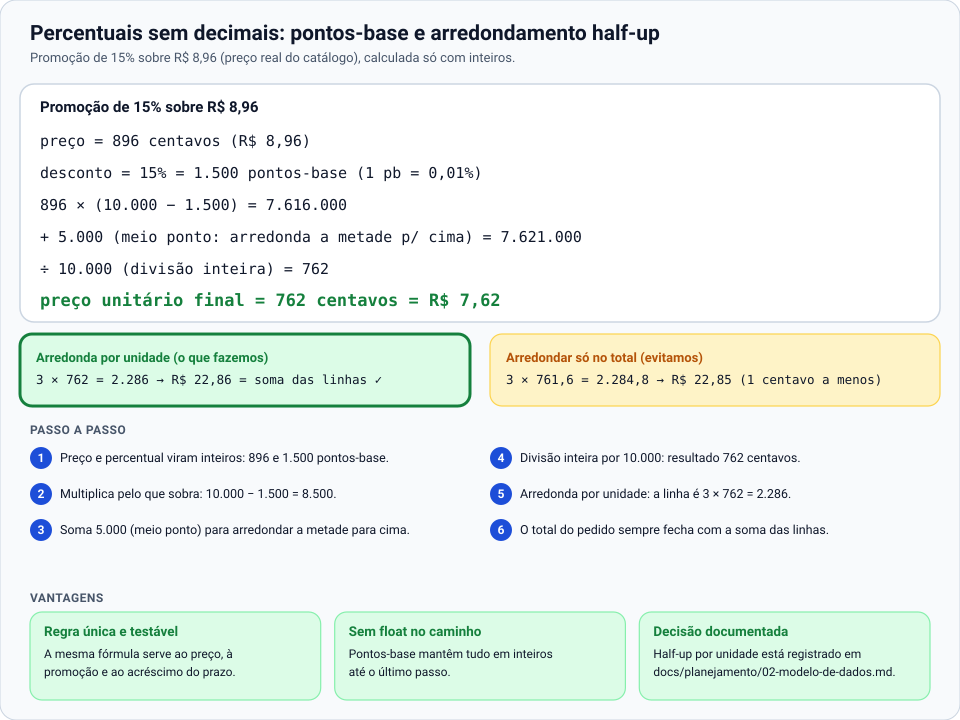
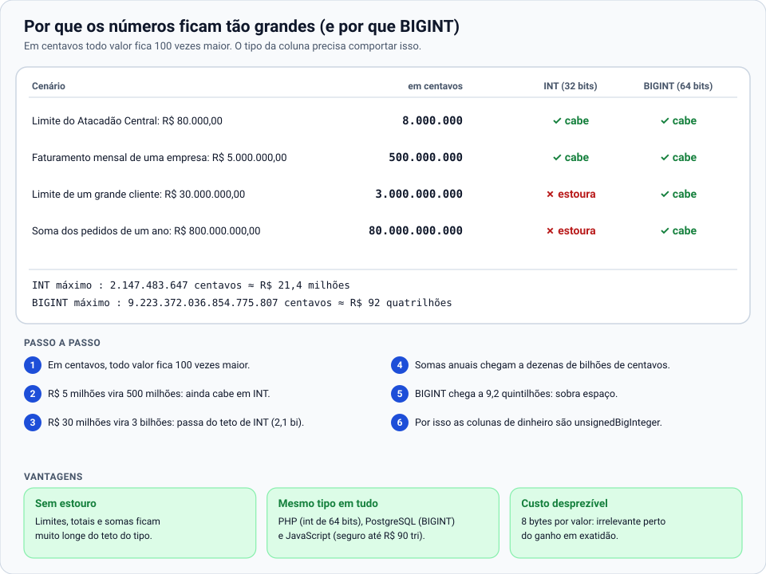
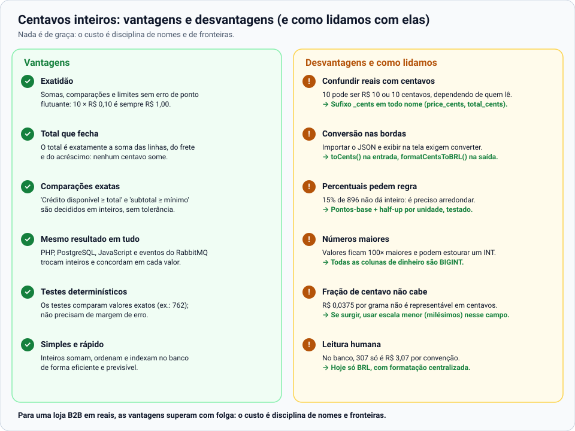

# Dinheiro em centavos: por que e como

Em toda a loja, **valores em dinheiro são números inteiros em centavos**: R$ 3,07 é guardado como `307`, e R$ 80.000,00 como `8.000.000`. Esta pasta explica o porquê, com imagens ilustrativas (SVGs: abra no navegador ou veja direto no GitHub). Só a imagem 2, que mostra o caminho do dinheiro, é animada; as demais são fixas, com todo o texto visível, para facilitar a leitura.

**Em uma frase:** computadores não guardam 0,1 com exatidão, mas guardam o inteiro 10 sem erro nenhum. Então trabalhamos com inteiros e só convertemos para "reais com vírgula" na hora de **exibir**.

---

## 1. O problema do ponto flutuante



Números decimais de computador (`float`) usam base 2 e não representam muitos valores simples de base 10, como 0,1. Cada operação carrega um erro minúsculo, que se acumula:

- somar R$ 0,10 dez vezes dá `0.9999999999999999`, e não `1.00`;
- `2.28 × 100` dá `227.99999999999997`; ao cortar a parte decimal (`(int)`), o resultado é `227`: **um centavo perdido**.

Isso não é teórico. No catálogo do desafio há **1.048 preços** (tabelas Padrão e Atacadista, preço normal e de atacado) e **112 deles** não viram inteiros exatos ao multiplicar por 100. Em **58**, cortar a parte decimal daria um centavo a menos. Em centavos, o `228` nunca precisa de conserto.

---

## 2. O caminho do dinheiro: entrada, cálculo e saída


A regra é **converter só nas bordas**:

- **Entrada:** o importador converte uma única vez, arredondando (`round(valor × 100)`).
- **Meio:** banco (`BIGINT`), preços, promoções, frete, acréscimo, pedido, pagamento e eventos do RabbitMQ (`total_in_cents`) usam **só inteiros**.
- **Saída:** a tela recebe centavos (`unitPriceCents: 307`) e só ao exibir formata `R$ 3,07`.

O preço gravado no pedido fica **congelado em centavos**, imune a mudanças futuras do catálogo.

---

## 3. Percentuais sem decimais: pontos-base e half-up



Percentuais também viram inteiros. **1 ponto-base = 0,01%**, então 15% são `1.500` pontos-base e 2,5% são `250`.

Promoção de 15% sobre R$ 8,96 (`896` centavos):

```
896 × (10.000 − 1.500) = 7.616.000
+ 5.000                = 7.621.000   (meio ponto: arredonda a metade para cima)
÷ 10.000 (inteira)     = 762         → R$ 7,62
```

O arredondamento é feito **por unidade**: 3 unidades são `3 × 762 = 2.286` (R$ 22,86), exatamente a soma das linhas da nota. Arredondar só no total daria R$ 22,85 e o pedido não fecharia com as suas linhas. A mesma fórmula serve ao preço, à promoção e ao acréscimo da condição de pagamento (sobre subtotal + frete).

---

## 4. Por que os números ficam tão grandes



Em centavos, todo valor fica 100 vezes maior. Um `INT` de 32 bits guarda até `2.147.483.647` centavos, cerca de **R$ 21,4 milhões**. Limites de crédito de empresas grandes e somas de pedidos passam disso com facilidade. Por isso **toda coluna de dinheiro é `BIGINT`** (`unsignedBigInteger`), que vai até `9.223.372.036.854.775.807` (cerca de R$ 92 quatrilhões).

PHP (inteiro de 64 bits), PostgreSQL (`BIGINT`) e JavaScript (inteiros seguros até `9.007.199.254.740.991`, cerca de R$ 90 trilhões) comportam esses valores sem perda.

---

## 5. Vantagens e desvantagens



| Vantagens                                         | Desvantagens                              | Como lidamos                                             |
| ------------------------------------------------- | ----------------------------------------- | -------------------------------------------------------- |
| Exatidão: somas e comparações sem erro de `float` | Confundir reais com centavos              | Sufixo `_cents` em todo nome                             |
| O total é exatamente a soma das linhas            | Conversão nas bordas                      | `toCents()` na entrada e `formatCentsToBRL()` na saída   |
| Comparações exatas (crédito, valor mínimo)        | Percentuais pedem regra de arredondamento | Pontos-base e half-up por unidade, documentado e testado |
| Mesmo resultado em PHP, PostgreSQL, JS e eventos  | Números 100× maiores podem estourar `INT` | Colunas `BIGINT`                                         |
| Testes determinísticos (comparam valores exatos)  | Fração de centavo não cabe                | Se surgir, usar escala menor (milésimos) no campo        |
| Inteiros somam, ordenam e indexam com eficiência  | Leitura humana; outras moedas             | Hoje só BRL, com formatação centralizada                 |

---

## Onde está no código

| O quê                                   | Onde                                                                    |
| --------------------------------------- | ----------------------------------------------------------------------- |
| Conversão de entrada (reais → centavos) | `CatalogImporter::toCents()` em `app/Catalog/CatalogImporter.php`       |
| Promoção em pontos-base (half-up)       | `PriceResolver` (`applyDiscount`) e `Promotion::discountBasisPoints()`  |
| Acréscimo da condição de pagamento      | `PaymentTermOptions::surchargeCents()`                                  |
| Totais do carrinho e do pedido          | `app/Cart/CartTotals.php`, `app/Orders/OrderCreator.php`                |
| Colunas de dinheiro                     | migrations (`*_cents`, `unsignedBigInteger`)                            |
| Eventos entre sistemas                  | `OrderCreated` e `OrderPaid` (`total_in_cents`)                         |
| Exibição (centavos → "R$ 3,07")         | `formatCentsToBRL()` em `resources/js/lib/format.ts`; `App\Support\Brl` |
| Regra de arredondamento documentada     | `docs/planejamento/02-modelo-de-dados.md` (seção "Cálculo de totais")   |

A tela divide por 100 apenas para **formatar** o texto (`Intl.NumberFormat`). Nenhuma conta de negócio usa esse valor.

---

## Regras de ouro para quem mexe no código

1. **Nunca** use `float` ou `double` para dinheiro. Nem para "só um cálculo rápido".
2. **Todo nome em dinheiro termina em `_cents`** (ou `Cents` no front): `price_cents`, `totalCents`.
3. Converta **só nas bordas**: importar dados externos e exibir na tela.
4. Percentuais: pontos-base e arredondamento **half-up por unidade**, nunca no total.
5. Colunas novas de dinheiro: `unsignedBigInteger`.
6. Testes comparam **valores exatos** em centavos, sem margem de erro.

## E o tipo `DECIMAL`?

Uma alternativa comum é `NUMERIC(12, 2)` no PostgreSQL com uma biblioteca de decimais no código. Funciona e é legível no banco, mas exige cuidado em cada camada (PHP, JSON e JavaScript tratam decimais de formas diferentes) e é fácil deixar um `float` escapar no caminho. Com inteiros, o tipo é o mesmo em todas as camadas e o erro de ponto flutuante simplesmente não existe. Para uma loja em uma moeda só, que arredonda por unidade, centavos inteiros foram a opção mais simples e segura.
