# Mensageria na loja: fluxos animados

Estas animações mostram **como o RabbitMQ entra na loja B2B** e por que isso ajuda. Os arquivos são SVGs animados: abra no navegador ou veja direto no GitHub. Quem prefere menos movimento vê as imagens paradas (as animações respeitam `prefers-reduced-motion`), com o passo a passo e as vantagens escritos em cada uma.

A loja usa o RabbitMQ de dois jeitos diferentes:

| Uso                        | O que é                                                             | Onde está                                       |
| -------------------------- | ------------------------------------------------------------------- | ----------------------------------------------- |
| **Fila de trabalho**       | A loja agenda um serviço para depois e um _worker_ o executa.       | `QUEUE_CONNECTION=rabbitmq`, `config/queue.php` |
| **Eventos entre sistemas** | A loja anuncia "aconteceu X" e quem tiver interesse escuta e reage. | `app/Messaging`, `config/messaging.php`         |

---

## 1. Pagamento assíncrono (fila de trabalho)

**Já implementado.** O checkout cria o pedido, reserva estoque e crédito, responde na hora e coloca o job `ProcessOrderPayment` na fila. O worker cobra no gateway (simulado), refaz a cobrança se houver erro temporário e, ao aprovar, baixa o estoque, esvazia o carrinho, envia o e-mail e avisa a tela do cliente em tempo real pelo Reverb.

**Vantagens**

- O cliente não espera o gateway: vai direto para a tela de acompanhamento.
- Falhas temporárias se resolvem sozinhas (espera crescente: 2, 5, 10 e 20 s); só a falha definitiva fecha o pedido.
- Em picos de pedidos, o trabalho vira fila em vez de derrubar o servidor.

**Onde ver no código:** `app/Orders/OrderCreator.php`, `app/Jobs/ProcessOrderPayment.php`, `app/Orders/PaymentProcessor.php`.

---

## 2. Eventos de integração (publicar e deixar cada sistema reagir)

**Parcialmente implementado.** A loja **já publica** `order.created` e `order.paid` no exchange `orders` (tipo _topic_), somente depois do _commit_ da transação, para nunca anunciar um pedido que não existe. Os consumidores do desenho (faturamento/ERP, depósito, mais vendidos) são **exemplos do que faria sentido**; hoje não há consumidores reais desses eventos.

**Vantagens**

- Baixo acoplamento: a loja publica um fato (pedido pago) e não sabe quem escuta.
- Cada sistema consome no seu ritmo: um ERP lento não atrasa o depósito nem o checkout do próximo cliente.
- Falha isolada: uma mensagem problemática vai para a DLQ e as demais seguem.
- Novo interessado? Cria-se outra fila ligada ao exchange, sem mudar a loja.

**Onde ver no código:** `app/Messaging` (`QueuedEventPublisher`, `Events/OrderCreated`, `Events/OrderPaid`) e `config/messaging.php`.

---

## 3. Rastreamento de entregas

**Fluxo alvo.** O módulo de mensageria já foi desenhado para escutar um serviço de rastreio (fila `ecommerce.deliveries`, eventos `delivery.status_updated` e `delivery.route_updated`, com DLQ e controle de duplicatas), mas o tratador atual apenas registra a mensagem. **Hoje a loja simula** esses eventos com um agendador (`orders:track`), cidade a cidade, e só o evento de entrega fecha o pedido como "Entregue".

**Vantagens**

- Dados reais da transportadora, sem simular.
- Sem consultas repetidas: a transportadora avisa quando há novidade.
- A tela do cliente acompanha ao vivo, sem recarregar.

**Onde ver no código:** `app/Orders/ShipmentTracker.php` e `ShipmentRoute.php` (simulação) e `config/messaging.php`, chave `consumers` (fluxo alvo).

---

## 4. Resiliência: duplicatas, novas tentativas e DLQ

A mensageria entrega "pelo menos uma vez", então o sistema precisa se comportar bem quando algo dá errado:

1. **Mensagem duplicada:** o consumidor é idempotente. A mesma mensagem recebida duas vezes tem o efeito de uma só. Na loja, `PaymentProcessor` não faz nada se o pedido já saiu de "aguardando pagamento", e o consumo de eventos usa `ProcessedEventStore`.
2. **Falha temporária:** o job tenta de novo com espera crescente. O cliente nem percebe a instabilidade.
3. **Falha definitiva:** esgotadas as tentativas, o pedido fecha como "pagamento falhou", o estoque e o limite de crédito reservados voltam a ficar disponíveis, o cliente recebe um e-mail e pode tentar outra forma de pagamento.

---

## O que NÃO vai para a fila

Nem tudo deve ser assíncrono. Na loja, continuam **síncronos**:

- a **reserva de estoque e de crédito**, com lock de linha dentro da transação do pedido (evita vender o mesmo estoque duas vezes);
- o **preço e a disponibilidade** exibidos na tela, que o cliente precisa na hora.

Só entra na fila o que é lento, instável ou precisa ser repetido: cobrar no gateway, enviar e-mail e avisar outros sistemas.
